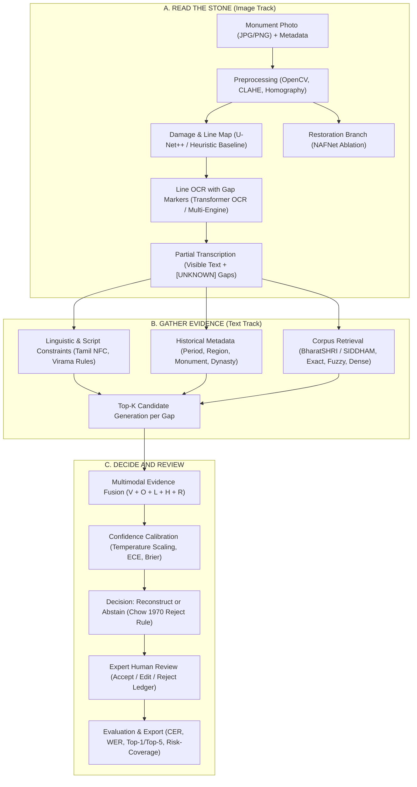

# EpiRecover: Evidence-Grounded Multimodal Reconstruction of Damaged Ancient Indian Inscriptions from Monument Imagery

[](https://www.python.org/downloads/)
[](https://opensource.org/licenses/MIT)
[]()
[-gold.svg)]()
[]()

> **EpiRecover** is an evidence-grounded computational epigraphy research project developed for a B.Tech in Artificial Intelligence & Data Science, based on the primary architecture specification `EpiRecover_Project_Work_I.pptx`. It addresses the challenge of reading and reconstructing physically damaged ancient Indian stone inscriptions from monument imagery through multimodal evidence fusion without generative text fabrication.

---

## 1. Scope & Research Methodology (Strict Constraints)

### A. Target Language Scope: Tamil Only
- **Active Target Language**: Exclusively locked to **Tamil** in this version (v0.1).
- **Target Writing Systems**:
  - **Modern Tamil Script**: Processed where standard OCR engines have installed language data (`tam.traineddata` or EasyOCR `ta`).
  - **Historical Tamil-Brahmi Script**: Explicitly separated from modern Tamil. Ancient lithic Tamil-Brahmi is marked as unsupported by generic off-the-shelf OCR models; candidate readings are grounded in verified epigraphic corpus retrieval and expert transcription rather than modern Tamil OCR guesswork.
- **Language Extensibility**: Other languages (Sanskrit, Prakrit, Kannada, Telugu) are preserved in the architecture schema for future expansion but are deactivated in the current version.

### B. Strict Non-Generative Model Guarantee (Zero Generative LLMs)
- **No Generative LLMs**: The system strictly excludes prompt-based LLMs (GPT, Gemini, Groq, or generative transformers) from generating inscription readings.
- **Evidence-Grounded Reconstruction**: Every reconstructed token is attributed to:
  1. `OBSERVED`: Directly observed character with high OCR confidence ($\ge 75\%$).
  2. `OCR_PRED`: Character hypothesis from OCR engine.
  3. `CORPUS_RETRIEVED`: Corroborated by verified epigraphic records (BharatSHRI, SIDDHAM).
  4. `MODEL_INFERRED`: Documented Tamil lithic confusion rules (e.g., weathered pulli/virama loss, stroke erosion).
  5. `UNKNOWN`: Explicit gap marker `[UNKNOWN]` for damaged or unresolvable regions.
  6. `HUMAN_REVIEWED`: Verified and accepted by a human epigraphist.

---

## 2. PPT Architecture Mapping

The architecture follows the three foundational stages of `EpiRecover_Project_Work_I.pptx` (Slides 11 & 12):



For the complete traceability table mapping every slide to source files and tests, see [docs/PPT_ARCHITECTURE_MAPPING.md](docs/PPT_ARCHITECTURE_MAPPING.md).

---

## 3. Technology Stack

| Technology | Role in EpiRecover |
|---|---|
| **Python 3.10+** (Active: 3.13) | Core implementation language |
| **PyTorch 2.11+** | U-Net++ segmentation, NAFNet restoration, and Transformer OCR architectures |
| **OpenCV & scikit-image** | Classical preprocessing (CLAHE, bilateral denoising, adaptive thresholding, homography) |
| **Hugging Face Transformers** | Non-generative vision and line OCR encoders |
| **Sentence-Transformers** | Dense vector similarity retrieval over historical corpus records |
| **scikit-learn** | Multimodal evidence fusion weights fitting, temperature scaling, calibration |
| **PostgreSQL & SQLite** | Structured historical epigraphic corpus and metadata storage |
| **FastAPI** | REST API backend for reconstruction, retrieval, review, and benchmark endpoints |
| **React/Vite** | Expert-review and visualization frontend |
| **Streamlit** | Multi-tab interactive research dashboard |
| **pytest** | 97 offline automated unit and regression tests |

---

## 4. Quick Start & Execution

### A. Run Automated Test Suite
To verify the complete 97-test suite (offline, zero external APIs required):
```bash
python -m pytest -v
```

### B. Launch Streamlit Research Dashboard
```bash
python -m streamlit run streamlit_app.py
```
Access at `http://localhost:8501`.

### C. Launch FastAPI Backend
```bash
python -m uvicorn src.api.main:app --port 8000 --reload
```
API Documentation available at `http://localhost:8000/docs`.

### D. Launch React/Vite Review Frontend
```bash
cd frontend
npm install
npm run dev
```
Access at `http://localhost:5173`.

### E. Run CLI Pipeline on an Inscription
```bash
python epirecover_pipeline.py data/raw/synthetic_ashoka_sample.png \
    --script-hint tamil \
    --out outputs/predictions/
```

---

## 5. Repository Structure

```
EpiRecover/
├── epirecover_pipeline.py           # Core orchestrator running Stages A through G
├── streamlit_app.py                 # Streamlit interactive research dashboard
├── preprocessing.py                 # Stage B: OpenCV image processing pipeline
├── ocr_engine.py                    # Stage D: Multi-engine OCR wrapper & Tamil support check
├── dataset_matcher.py               # Token dictionary & glyph transliterator
├── utils.py                         # RecoveryReport, ReconstructionCandidate, Provenance dataclasses
├── config/
│   └── epirecover.yaml              # Pipeline thresholds and fusion weights
├── data/
│   ├── annotations/                 # Ground truth evaluation fixtures (NFC normalized)
│   ├── corpus/                      # Epigraphic reference corpora (BharatSHRI, Tamil sample)
│   └── raw/                         # Raw sample inscription imagery
├── docs/
│   ├── RECONSTRUCTION_DIAGNOSTIC_REPORT.md # Root-cause diagnosis of poor reconstruction & defect audit
│   ├── PPT_ARCHITECTURE_MAPPING.md  # PPT stage-by-stage requirement traceability
│   ├── VERIFICATION_REPORT.md       # Audit results, environment checks, and test reports
│   ├── IMPLEMENTATION_STATUS.md     # Feature status and test verification counts
│   ├── ARCHITECTURE.md              # System design specification
│   ├── DATASET_GUIDE.md             # BharatSHRI, SIDDHAM, and EpiSAM dataset guide
│   └── EVALUATION_PROTOCOL.md       # CER, WER, Top-K, and calibration protocols
├── frontend/                        # React/Vite expert review interface
│   ├── src/
│   │   ├── App.jsx                  # Main review and reconstruction UI
│   │   └── index.css                # Curated dark-mode design system
│   ├── package.json
│   └── vite.config.js
├── src/
│   ├── api/                         # FastAPI REST endpoints (main.py)
│   ├── candidate_ranking/           # Evidence fusion, calibration, and abstention
│   ├── damage_analysis/             # Heuristic baseline, UNet++, YOLO detector
│   ├── evaluation/                  # CER/WER metrics, evaluator, D0-D6 synthetic damage
│   ├── evidence_retrieval/          # Corpus adapter, retriever, PostgreSQL adapter
│   ├── ocr/                         # Transformer line OCR with gap markers
│   ├── reconstruction/              # Non-generative candidate generator
│   ├── restoration/                 # NAFNet enhancement ablation branch
│   └── review/                      # Human review decision store
└── tests/                           # 117 passing automated test cases (including regression suite)
```

---

## 6. Known Environment Limitations & Audit Notes

1. **Host OCR Binaries**:
   - The pipeline checks host OCR engines dynamically via `ocr_engine.check_tamil_ocr_support()`.
   - If Tesseract with `tam.traineddata` or EasyOCR is not installed on the host operating system, the system transparently reports OCR unavailability instead of fabricating text.
2. **Pretrained Neural Weights**:
   - PyTorch architectures for U-Net++ and NAFNet are implemented. When weights files are absent in `models/`, the system honestly defaults to classical baselines (`HEURISTIC_BASELINE` for damage, bilateral filtering for restoration) without claiming deep learning inference.
3. **Synthetic Fixtures**:
   - Small synthetic fixtures (`data/corpus/tamil_inscriptions_sample.jsonl`, `data/annotations/tamil_eval_fixture.json`) are provided for testing offline without requiring multi-gigabyte archaeological downloads.
