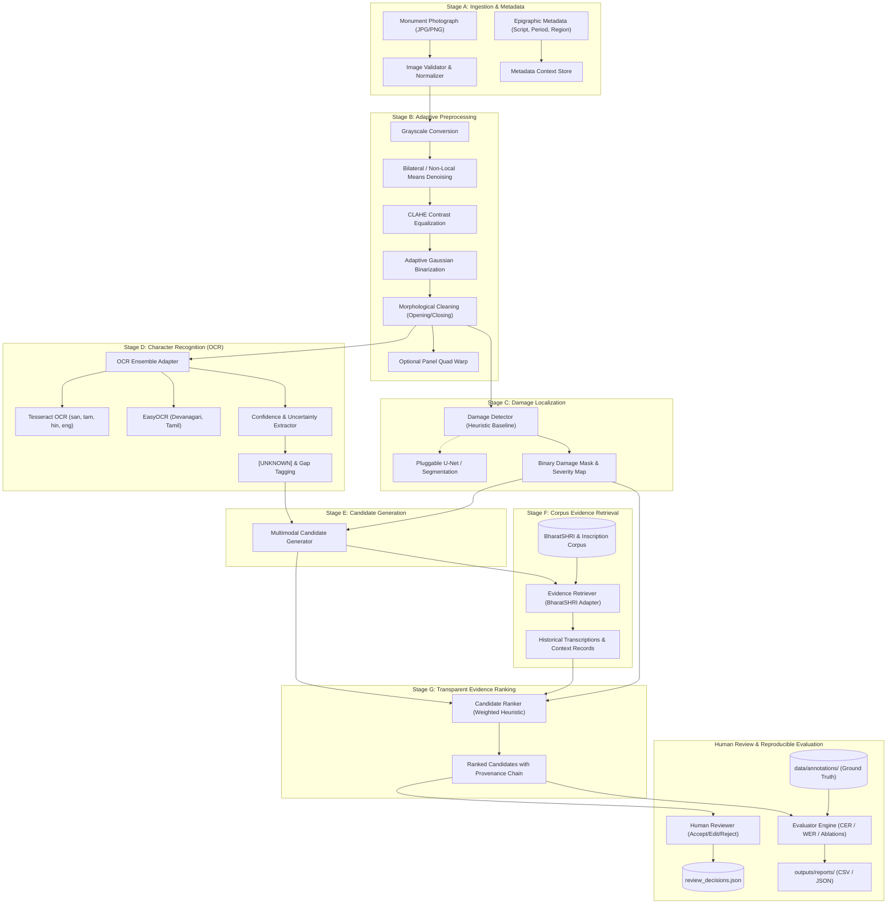

# EpiRecover — System Architecture & Design Specification

**Project**: EpiRecover: Evidence-Grounded Multimodal Reconstruction of Damaged Ancient Indian Inscriptions from Monument Imagery  
**Academic Context**: B.Tech AI & Data Science Research Project  
**Base Repository**: Extended from `sam-r-148/EpiQ` (MIT License)

---

## 1. Executive Summary & Research Vision

Ancient Indian stone inscriptions (lithic epigraphs) across monuments, pillars, temple walls, and rock shelters represent foundational historical records spanning over two millennia (from 3rd-century BCE Ashokan edicts in Brahmi to medieval Sanskrit, Prakrit, Devanagari, and Tamil records). However, monument imagery is frequently subject to severe degradation:
- Surface erosion, flaking, and salt crystallization
- Structural fissures, fractures, and spalling
- Bio-deterioration (lichen, moss, water staining)
- Non-uniform lighting, relief shadows, and harsh oblique sunlight
- Missing glyph chunks and unreadable damaged regions

**EpiRecover** transitions epigraphic processing from naive OCR/LLM generation to a scientifically grounded, multimodal reconstruction framework. Its central design tenet is **Evidential Integrity**: every character hypothesis is strictly attributed to visual observations, OCR hypotheses, historical corpus records, or model inference, while gaps lacking sufficient evidence are preserved as explicit `[UNKNOWN]` markers rather than hallucinated text.

---

## 2. End-to-End Pipeline Architecture

The pipeline consists of seven modular stages (A through G) followed by human verification and quantitative evaluation:

---

## 3. Core Component Specifications

### 3.1 Preprocessing Pipeline (`preprocessing.py`)
- **Grayscale Conversion**: Supports BGR, BGRA, and luminance normalization.
- **Bilateral Filtering**: Preserves character stroke relief while suppressing stone grain texture.
- **CLAHE (Contrast Limited Adaptive Histogram Equalization)**: Equalizes varying sunlight patterns across massive stone surfaces.
- **Adaptive Thresholding**: Dynamically isolates carved strokes under non-uniform illumination.
- **Morphological Operations**: Removes pinhole noise and fills disconnected stroke micro-gaps.
- **Perspective Rectification**: Identifies panel quadrilaterals via contour approximation and computes homography matrix for unwarped orthophotos.

### 3.2 Damage Analysis (`src/damage_analysis/damage_detector.py`)
- **Baseline Engine**: Evaluates local stroke density, variance of Laplacian (blur/wear), and morphological irregularity to estimate damaged areas.
- **Scientific Labeling**: Every output is stamped `HEURISTIC_BASELINE` to guarantee transparency.
- **Extensibility Interface**: Exposes a clean `DamageSegmentationModel` abstract protocol ready for fine-tuned U-Net, U-Net++, or SegFormer backends.

### 3.3 OCR & Uncertainty Engine (`ocr_engine.py`)
- Employs a multi-backend adapter supporting Tesseract and EasyOCR.
- Extracts character-level or token-level bounding boxes and confidence scores.
- Where confidence falls below threshold $\tau_{\text{ocr}}$, characters are transformed into explicit uncertainty markers `⟨candidate⟩` or `[UNKNOWN]` rather than silent guesses.

### 3.4 Candidate Reconstruction (`src/reconstruction/candidate_generator.py`)
- Generates hypothesis readings incorporating:
  1. High-confidence OCR segments (`OBSERVED`)
  2. Dictionary and token lookups (`CORPUS`)
  3. Context-constrained fallback inferences (`INFERRED`)
  4. Gaps with unresolved evidence (`UNKNOWN`)
- Strictly forbids fabrication of epigraphical sources or ungrounded historical claims.

### 3.5 Evidence Retrieval Engine (`src/evidence_retrieval/`)
- **Corpus Adapter (`corpus_adapter.py`)**: Ingests JSON, JSONL, and CSV epigraphic metadata conforming to standard fields (transcription, script, period, region, monument, citation).
- **Retriever (`retriever.py`)**: Employs a 3-tier retrieval cascade:
  1. *Tier 1*: Exact inscription identifier or full text lookup.
  2. *Tier 2*: Normalized Levenshtein / token-overlap fuzzy match.
  3. *Tier 3*: Optional dense semantic embeddings (Sentence-Transformers + FAISS) when available.
- **Anti-Leakage Safeguard**: During testing and benchmarking, evaluation record IDs are explicitly excluded from retrieval indexes.

### 3.6 Candidate Ranker (`src/candidate_ranking/ranker.py`)
Candidates are scored through an explicit multi-factor weighting scheme:
$$S(c) = w_{\text{vis}} S_{\text{vis}}(c) + w_{\text{ocr}} S_{\text{ocr}}(c) + w_{\text{corp}} S_{\text{corp}}(c) + w_{\text{ctx}} S_{\text{ctx}}(c) + w_{\text{qual}} S_{\text{qual}}(c)$$
- Default weights: Visual (0.25), OCR (0.25), Corpus (0.25), Context (0.15), Quality (0.10).
- Transparent auditing: The full score breakdown per factor is attached to every candidate for auditability.

### 3.7 Evaluation & Metrics (`src/evaluation/`)
- Character Error Rate (CER) and Word Error Rate (WER) computed via Levenshtein edit distance.
- Baseline vs. Preprocessed ablation comparison.
- Per-script and per-damage-level stratification.
- Strictly reports `metric_unavailable_reason` if ground truth reference transcription is absent, refusing to simulate or invent accuracy scores.

---

## 4. Provenance Tracking Model

Every character token in EpiRecover is assigned one of six immutable provenance states:

| Provenance Enum | Description | Permitted Sources |
|---|---|---|
| `OBSERVED` | Visible on monument panel with high OCR confidence | High-confidence OCR ($\ge 75\%$) |
| `OCR_PRED` | Hypothesis predicted by OCR model | Low/Medium confidence OCR |
| `CORPUS_RETRIEVED` | Grounded in epigraphic corpus records | BharatSHRI, ASI Epigraphia Indica |
| `MODEL_INFERRED` | Contextually suggested by LLM / Heuristic | GenAI post-processor, n-gram model |
| `HUMAN_REVIEWED` | Verified or edited by human epigraphist | Streamlit Review Panel |
| `UNKNOWN` | Unresolvable damage with insufficient evidence | Gap marker |

---

## 5. Security, Config & Data Isolation

- All configuration parameters reside in `config/epirecover.yaml`.
- API keys (Gemini, Groq) are loaded strictly via `.env` or environment variables; never logged or serialized.
- The pipeline functions in complete offline / no-API mode using `StubTranslator` and local heuristics.
